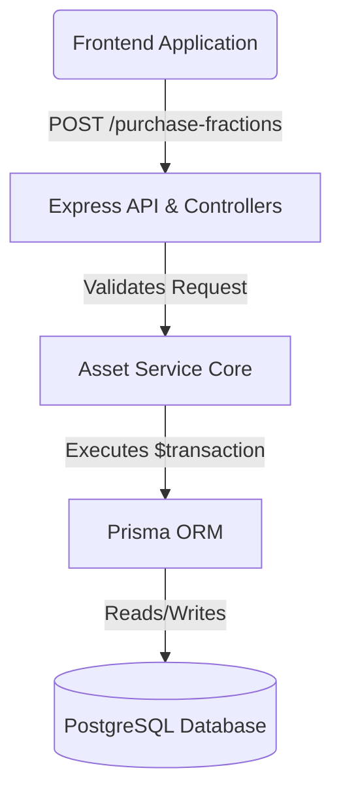
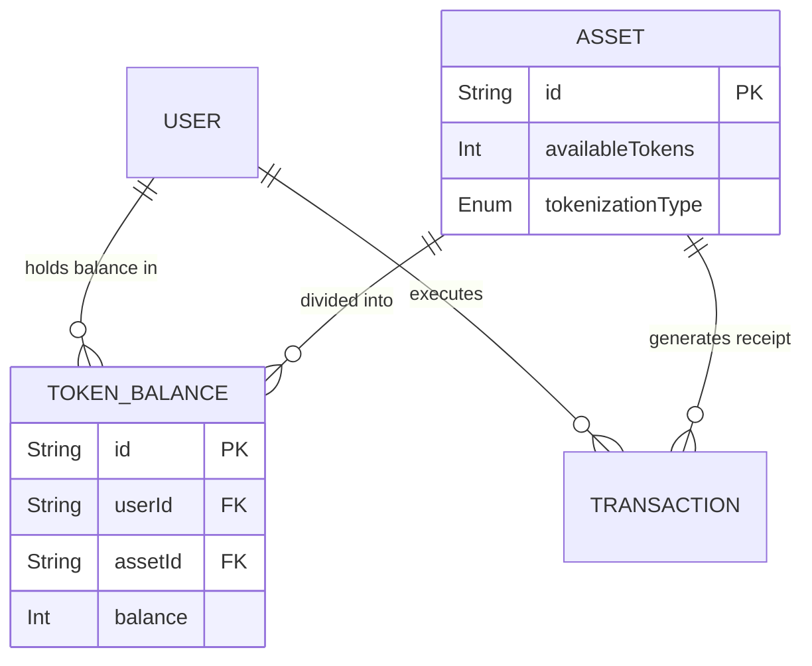
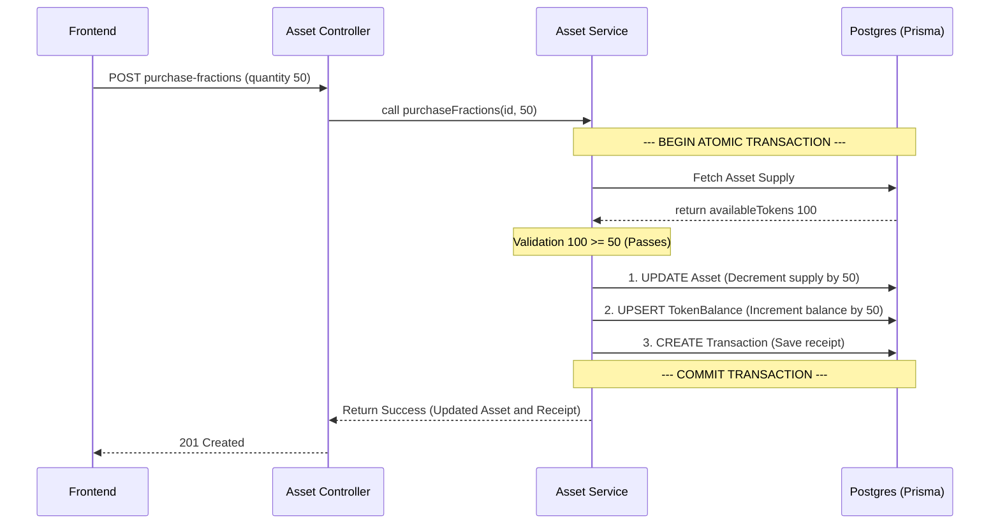

# 🏗️ Fractional Ownership - System Design

## 📖 Overview
This document outlines the High-Level Design (HLD) and Low-Level Design (LLD) for the Fractional Ownership feature within the Real World Asset (RWAvenue) backend infrastructure.

---

## 🏗️ 1. High-Level Design (HLD)

### 📌 Architectural Components
The Fractional Ownership system follows a robust 3-tier Node.js architecture:
- **Transport Layer (Controllers):** Handles HTTP requests, extracts payload data (`quantity`, `assetId`), and formats standard API responses.
- **Business Layer (Services):** Encapsulates the core math, validation logic, and atomic database transactions.
- **Data Layer (Prisma ORM):** Interacts securely with the PostgreSQL database.

### 🗺️ Architecture Flow Diagram

---

## ⚙️ 2. Low-Level Design (LLD)

### 🗄️ Database Schema Design
To support fractional tracking, we introduced a centralized ledger table.

| Table Name | Purpose | Key Fields |
| :--- | :--- | :--- |
| **`Asset`** | Tracks total & circulating supply | `totalTokens`, `availableTokens`, `tokenizationType` |
| **`TokenBalance`** | The ledger linking users to assets | `userId`, `assetId`, `balance` |
| **`Transaction`** | The historical receipt log | `type`, `amount`, `tokensAmount` |

### 🔗 Entity Relationship Diagram (ERD)

---

## 🔄 3. Process Flow & Core Algorithm

### 🔐 Atomic Purchase Algorithm
The `purchaseFractions` function is strictly governed by an atomic database transaction to prevent over-selling or corrupted balances.

1. **Validation:** Ensure `asset.tokenizationType === 'fractional'` and `availableTokens >= requestedQuantity`.
2. **Mutation A (Supply):** Decrement the `availableTokens` on the Asset.
3. **Mutation B (Ledger):** Upsert the user's `TokenBalance` (Create if new, Increment if existing).
4. **Mutation C (Receipt):** Create a `Transaction` log with `tokensAmount`.
5. **Commit:** All 3 mutations are committed simultaneously.

### 🌊 Sequential Flow Diagram

